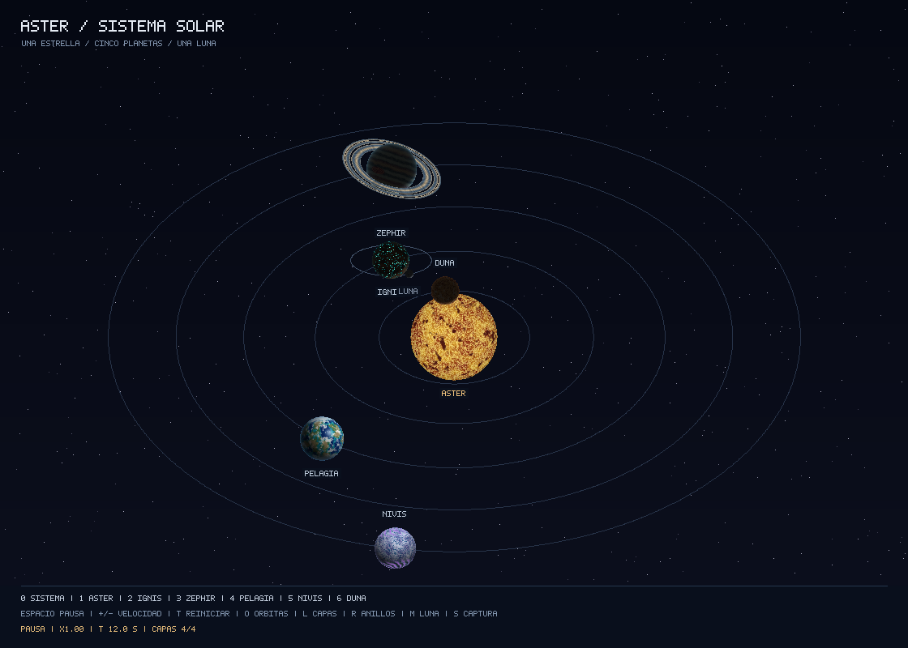

# Auditoria del Lab 5 contra la rubrica

Fecha: 6 de noviembre de 2026. Revision auditada: `932725626e9b2b652086f7934a8958760d0c2043`, rama `main`.

## Dictamen

No se encontraron incumplimientos de los cuatro criterios tecnicos puntuados.
La estimacion de cumplimiento es **110/110 puntos tecnicos**, mas **hasta 30
puntos de creatividad**, para un maximo de **140 puntos** segun la imagen de la
rubrica. Es una evaluacion tecnica local, no una calificacion oficial: el docente
decide la aceptacion de las capas y el criterio subjetivo.

Se encontro un defecto menor de presentacion en las etiquetas de la vista del
sistema. No afecta los shaders, los anillos, la existencia de la luna ni su movimiento.
Durante esta auditoria no se modificaron archivos de implementacion; se agregaron
este informe y una captura que reproduce el hallazgo.

## Hallazgo: P3 — Etiquetas IGNIS y LUNA superpuestas

En la vista del sistema, en el segundo 12, las etiquetas de Ignis y su luna
quedan superpuestas. La causa esta en `src/scene.rs`, linea 255: cuando ninguna
de las seis posiciones candidatas pasa la prueba `fits`, el codigo usa la primera
posicion sin comprobar otra vez las colisiones. Ese fallback permite tapar un
nombre que ya se habia colocado.

Reproduccion interactiva:

```sh
cargo run --release -- --view sistema --time 12 --paused
```

Reproduccion sin ventana:

```sh
cargo run --release -- --view sistema --time 12 --export-only --output auditoria/sistema_t12.png
```



Recomendacion: buscar mas posiciones libres o usar una etiqueta con linea guia
cuando se agoten las candidatas. El fallback debe conservar la comprobacion de
colisiones. Prioridad baja: afecta la lectura de nombres en determinadas fases,
pero las etiquetas no son un requisito puntuado en esta rubrica.

## Evaluacion criterio por criterio

| Criterio de la rubrica | Maximo | Evaluacion | Evidencia |
| --- | ---: | --- | --- |
| Criterio subjetivo / creatividad | 30 | Pendiente del docente | Seis disenos reconocibles con paletas y fenomenos distintos: plasma, roca volcanica, bandas gaseosas, oceanos, hielo y desierto. Las vistas individuales permiten evaluar los detalles. |
| Complejidad de shaders: cuatro capas de color | 40 | Cumple: 40/40 propuestos | Cada shader principal tiene cuatro efectos de color acumulados. No son solo cuatro constantes RGB ni cuatro octavas de ruido. El control `L` y `--layers` permiten comprobar los pasos. |
| Tres planetas extras | 30 | Cumple: 30/30 propuestos | Pelagia, Nivis y Duna, ademas de Aster, Ignis y Zephir. La estrella y la luna no se cuentan como planetas extra. |
| Sistema de anillos en planeta gaseoso | 20 | Cumple: 20/20 propuestos | Zephir tiene una malla anular independiente, shader radial, divisiones sin textura y oclusion delante/detras de la esfera. |
| Luna en un planeta rocoso | 20 | Cumple: 20/20 propuestos | Ignis tiene una luna dibujada como instancia separada con centro, escala, rotacion y shader propios. Sigue al centro actual del planeta mientras orbita localmente. |

### Evidencia de las cuatro capas

| Cuerpo | Capa 1 | Capa 2 | Capa 3 | Capa 4 | Codigo |
| --- | --- | --- | --- | --- | --- |
| Aster | Conveccion del plasma | Granulacion | Filamentos | Manchas oscuras | `src/shaders.rs:67` |
| Ignis | Basalto y minerales | Grano fino | Crateres y bordes | Fracturas emisivas | `src/shaders.rs:123` |
| Zephir | Bandas por latitud | Cinturones de color | Nubes finas | Tormenta con remolino | `src/shaders.rs:157` |
| Pelagia | Oceanos y continentes | Costas y relieve | Casquetes polares | Nubes | `src/shaders.rs:229` |
| Nivis | Placas de hielo | Fisuras | Escarcha | Auroras | `src/shaders.rs:266` |
| Duna | Arena y mesetas | Dunas | Salares | Polvo | `src/shaders.rs:302` |

La prueba `every_layer_changes_each_body_and_full_render_is_not_flat` compara las
cuatro configuraciones de cada uno de los seis cuerpos. Cada capa adicional
cambia mas de 100 pixeles en una imagen de 180 por 140; cada resultado completo
tiene mas de 500 colores distintos. Esto corrobora cambios efectivos de color,
ademas de la inspeccion del codigo. No sustituye el juicio visual del docente.

### Evidencia de los extras

- Los seis cuerpos estan enumerados en `src/scene.rs:22` y asociados a shaders distintos en `src/scene.rs:60`.
- La geometria del anillo se genera en `src/geometry.rs:55` y se dibuja por separado para `Body::Gas` en `src/scene.rs:339`.
- El shader del anillo esta en `src/shaders.rs:198`; sus divisiones descartan fragmentos en lugar de leer una imagen.
- La luna se dibuja para `Body::Rocky` en `src/scene.rs:348`. Reutilizar la geometria esferica no une los objetos: tiene otra transformacion y otra llamada al rasterizador.
- La relacion jerarquica lunar esta en `src/scene.rs:156`. Las cinco orbitas planetarias estan en `ORBITS`, y `Orbit::position` calcula la traslacion.

## Condiciones del enunciado original

| Condicion | Resultado |
| --- | --- |
| Renderizar una estrella, un rocoso y un gaseoso | Cumple; ademas hay tres planetas adicionales. |
| Software renderer propio | Cumple: proyeccion, rasterizacion baricentrica, interpolacion, shaders y buffer de profundidad se ejecutan en CPU. |
| Usar solo shaders, sin texturas ni materiales | Cumple en el codigo revisado: los patrones usan ruido 3D, senos, distancias y mezclas RGB. No hay lectura de texturas ni archivos de materiales. `image` solo exporta PNG; `minifb` presenta los pixeles. |
| Anillos y luna separados del planeta | Cumple: anillo con otra malla; luna con otra instancia, transformacion y shader. |
| Capturas en el README | Cumple: seis vistas individuales, comparativa y sistema; las ocho referencias existen y sus PNG estan versionados. |
| Rotacion y traslacion opcionales | Implementadas: cinco planetas orbitan el Sol y giran sobre su eje; la luna orbita Ignis. Este movimiento no agrega un criterio con puntos en la ultima rubrica adjunta. |

## Verificaciones ejecutadas

| Comprobacion | Resultado |
| --- | --- |
| `cargo fmt --all -- --check` | Pasa. |
| `cargo test --offline` | Pasan las 10 pruebas. |
| `cargo clippy --offline --all-targets -- -D warnings` | Pasa, sin diagnosticos de Clippy que bloqueen el comando. |
| `cargo build --release --offline` | Pasa. |
| Exportacion completa desde una carpeta temporal | Se generan los ocho PNG sin abrir una ventana. |
| Comparacion SHA-256 entre los PNG regenerados y los versionados | Coinciden los ocho: estrella, rocoso, gaseoso, oceanico, helado, desertico, comparativa y sistema. |
| Inspeccion visual | Se revisaron la comparativa, la vista individual de Ignis con su luna y el sistema en el segundo 12. |
| Movimiento y profundidad | Las pruebas verifican cinco orbitas cerradas y de radio constante, seguimiento lunar del padre movil, cuadros reproducibles, iluminacion y oclusion de anillos independiente del orden de dibujo. |

Cargo emite avisos del cache incremental porque no puede crear algunos enlaces
duros en esta ubicacion y copia los archivos; los comandos terminan correctamente.
No se considero esto un defecto del renderer.

La comprobacion de ejecucion de esta auditoria uso el exportador del mismo
framebuffer y las pruebas automaticas. No se repitio una sesion de controles
interactivos de la ventana en esta revision.

## Presentacion y limites de la revision

Conviene mostrar las vistas individuales `1` a `6` al evaluar los shaders:
en la vista del sistema algunos cuerpos se ven pequenos y oscuros por la
orientacion de la luz solar. Esto es coherente con la escena y no impide evaluar
los disenos en las capturas individuales. Una comparativa visual de capas seria
una mejora de evidencia, pero no es un requisito que falte en el enunciado.

El repositorio local estaba limpio al comenzar; `main` coincide con la referencia
local `origin/main`. Tiene configurado el remoto de GitHub `Naguirrel/Lab5_Graficas`.
Se intento consultar el commit remoto, pero el entorno no pudo resolver
`github.com`. Por eso esta auditoria no certifica el estado actual del servidor,
la visibilidad del repositorio ni la entrega del enlace en Canvas. El fallo de
red no demuestra que el repositorio este ausente o que los cambios no se hayan subido.

No se detectaron otros fallos que justifiquen descontar puntos tecnicos con la
rubrica proporcionada. Los 30 puntos subjetivos siguen dependiendo del docente.
