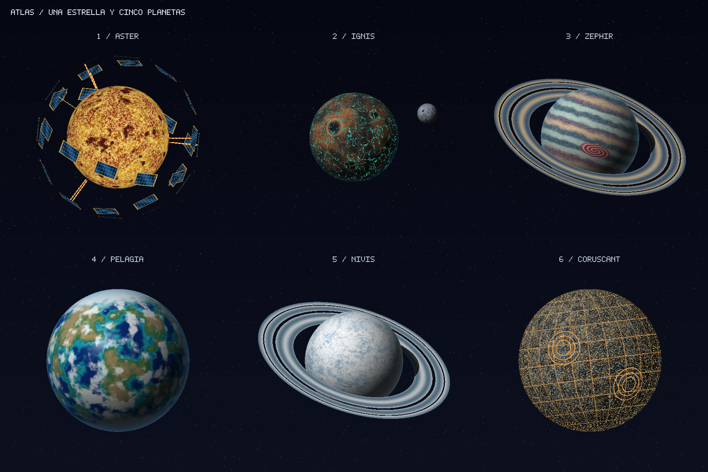
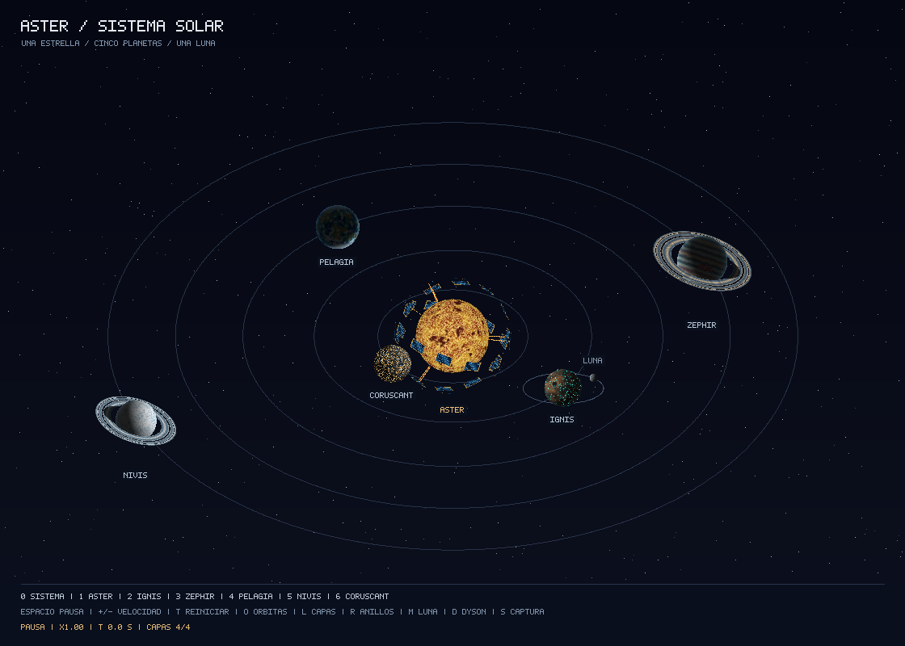
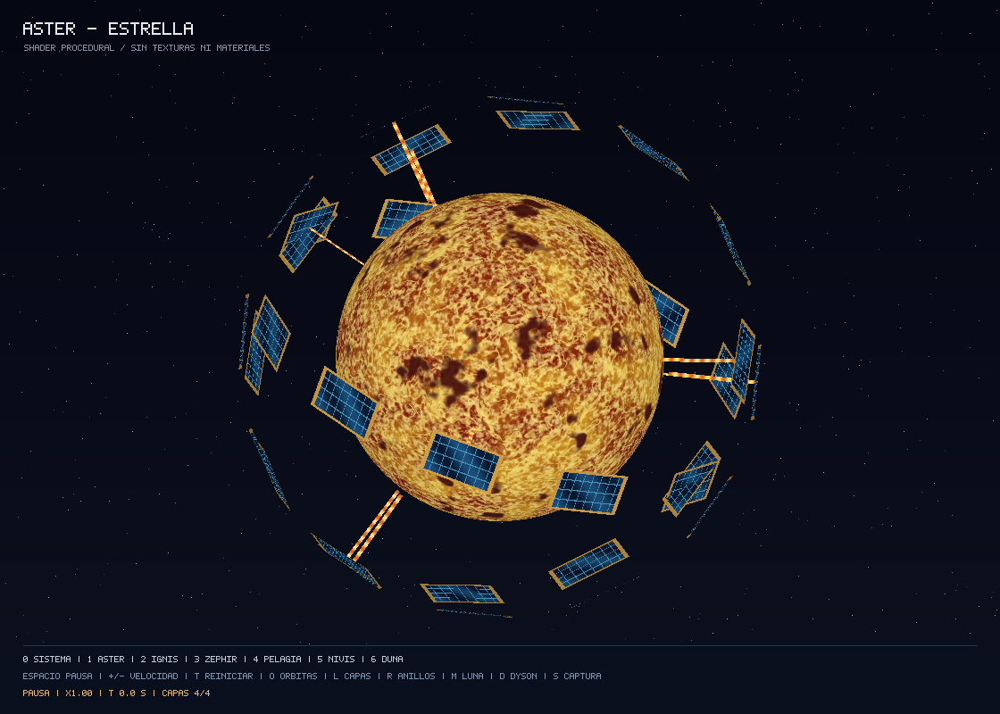
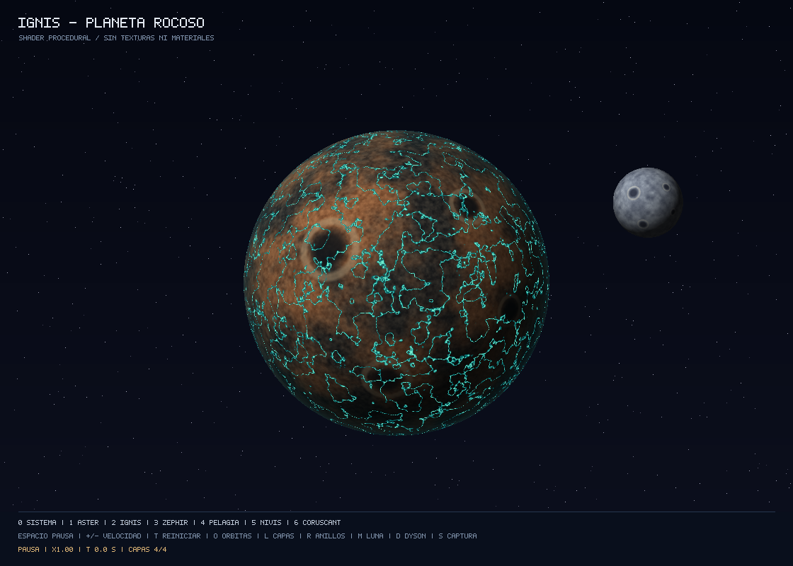
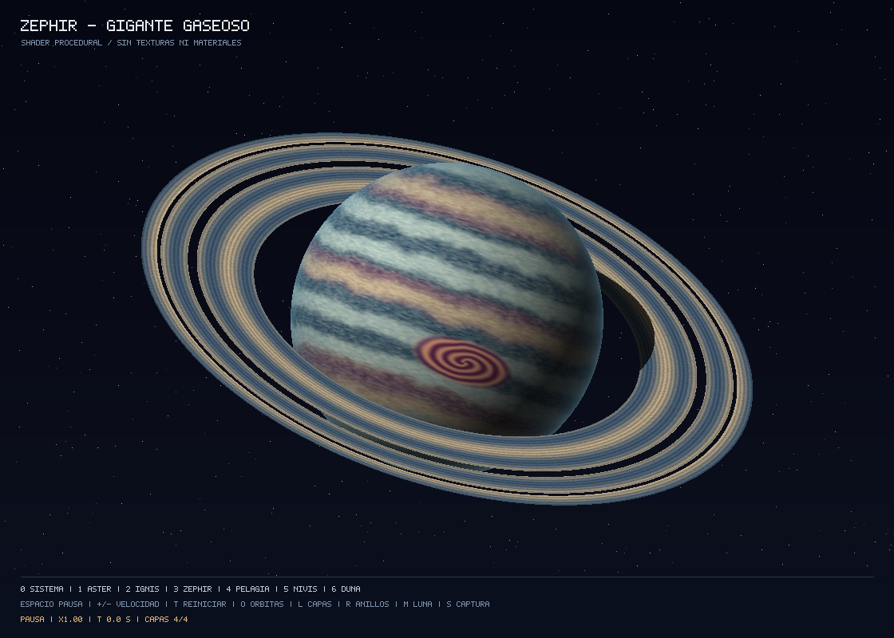
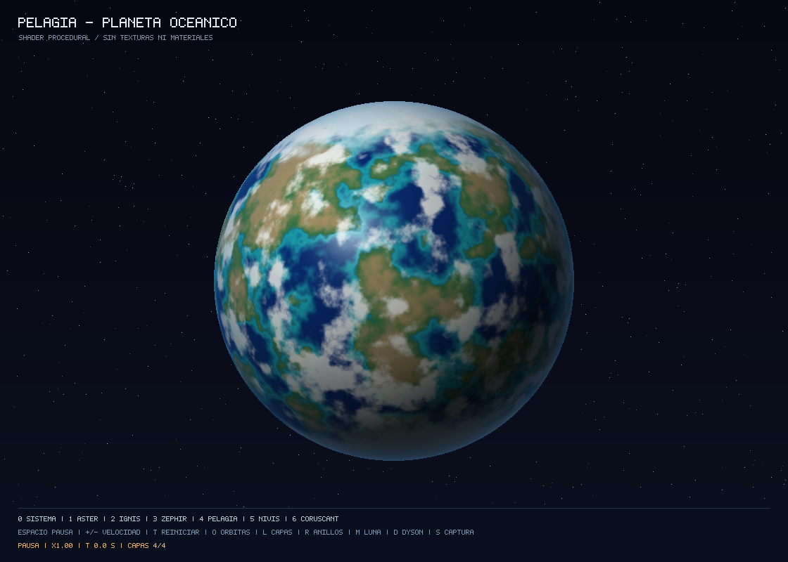
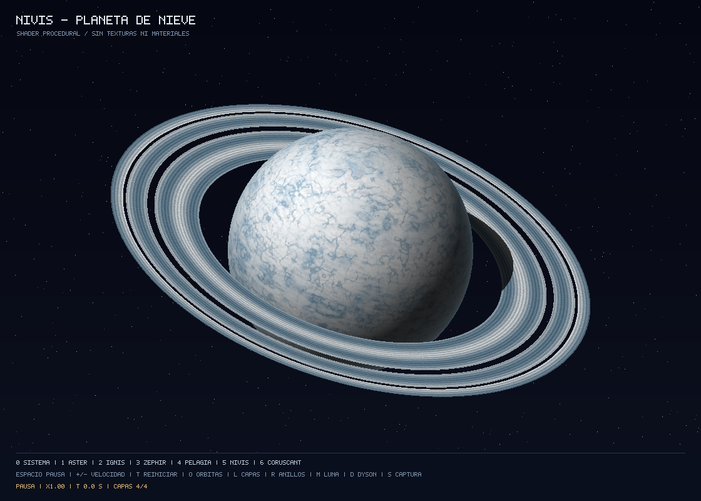
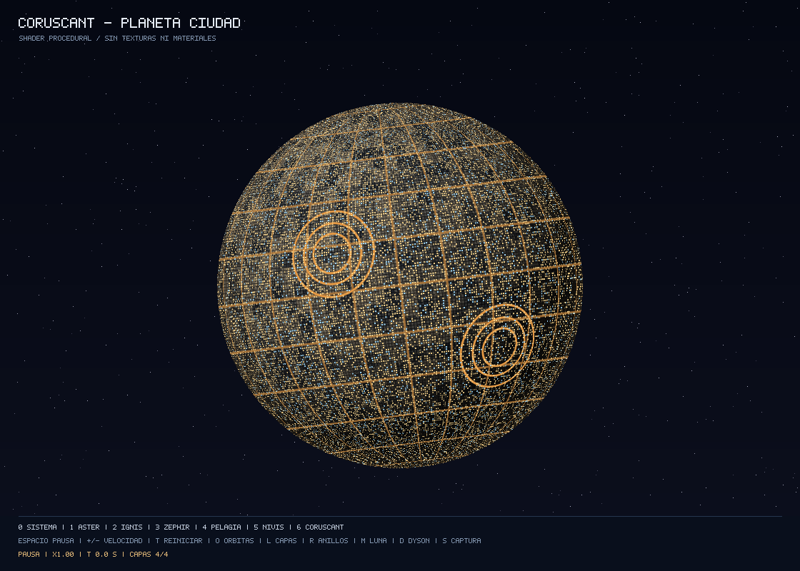

# Lab 5 — Sistema Aster: una estrella y cinco planetas

Software renderer en **Rust** que dibuja triangulos en CPU y calcula el color
de cada fragmento con shaders procedurales. No carga texturas, materiales,
imagenes de superficie ni shaders de Blender. Una esfera generada por codigo
se reutiliza para los seis cuerpos principales; anillos y luna se dibujan como objetos separados.

La fila superior muestra los tres cuerpos obligatorios: **Aster**, **Ignis** y
**Zephir**. La inferior muestra los tres planetas adicionales del bono:
**Pelagia**, **Nivis** y **Coruscant**. Cada uno tiene un shader de cuatro capas.



## Ejecutar

Requiere Rust y Cargo con soporte para la edicion 2024. Desde esta carpeta:

```sh
cargo run --release
```

El programa inicia en la **vista del sistema completo, con la animacion activa**.
El Sol permanece en el centro, los cinco planetas orbitan a distintas velocidades
y giran sobre su propio eje. La luna orbita Ignis mientras acompana su traslacion.
Hay siete vistas: una general y seis individuales.

La primera compilacion descarga las dependencias si no estan en la cache de Cargo.
`minifb` presenta nuestro framebuffer en una ventana; `image` unicamente guarda
los pixeles calculados en archivos PNG. Ninguna de estas bibliotecas dibuja los
triangulos ni calcula los patrones del planeta.

| Tecla | Accion |
| --- | --- |
| `0` | Vista del sistema completo |
| `1` / `2` / `3` | Aster, estrella / Ignis, rocoso / Zephir, gaseoso |
| `4` / `5` / `6` | Pelagia, oceanico / Nivis, nieve con anillos / Coruscant, ciudad |
| `L` | Cambiar capas acumuladas: 4 → 1 → 2 → 3 → 4 |
| Flechas izquierda / derecha | Individual: girar el cuerpo. Sistema: retroceder o avanzar el tiempo |
| Espacio | Pausar o reanudar toda la simulacion |
| `+` / `-` | Aumentar / reducir velocidad entre x0.25 y x4; tambien sirve `=` para aumentar |
| `T` | Reiniciar tiempo y rotacion manual |
| `O` | Mostrar u ocultar las guias de las orbitas |
| `R` | Mostrar u ocultar los anillos de Zephir y Nivis |
| `M` | Mostrar u ocultar luna del planeta rocoso |
| `D` | Mostrar u ocultar las placas del enjambre de Dyson alrededor del Sol |
| `S` / `F12` | Guardar el framebuffer actual en `screenshots/captura_<vista>.png` |
| Esc | Salir |

Se usa proyeccion ortografica. Las vistas individuales tienen luz fija para
estudiar los colores; en el sistema se calcula la direccion hacia el Sol para
cada cuerpo, incluida la luna. La estrella conserva su brillo propio.
La atmosfera es un cambio de color en el borde de la esfera, sin geometria
exterior ni textura. Se conservan el tiempo y la pausa al cambiar de vista.

## Vista del sistema y movimiento



Las orbitas son circulares en un plano 3D inclinado: se ven como elipses en
pantalla. Sus tamanos y periodos estan elegidos para una demostracion legible,
sin representar escalas astronomicas reales ni resolver fuerzas gravitacionales.

| Cuerpo | Traslacion a velocidad x1 |
| --- | --- |
| Coruscant | Una vuelta cada 18 segundos |
| Ignis | Una vuelta cada 28 segundos |
| Pelagia | Una vuelta cada 40 segundos |
| Zephir | Una vuelta cada 56 segundos |
| Nivis | Una vuelta cada 76 segundos |
| Luna de Ignis | Una vuelta LOCAL cada 7 segundos |

Cada cuerpo tiene, ademas, su propia velocidad de rotacion. El movimiento depende
del tiempo transcurrido, no de contar cuadros. La relacion jerarquica de la luna
es `posicion_luna = posicion_actual_Ignis + desplazamiento_orbital_local`.
El buffer de profundidad resuelve los cruces de objetos, la luna y los anillos.
No se simulan eclipses entre cuerpos; la sombra sobre el anillo se calcula
analiticamente. Las guias y los nombres son ayudas visuales dibujadas en codigo.

## Disenos y capas

Las capas son operaciones acumuladas dentro de cada shader; no son texturas
superpuestas ni necesariamente pasadas de dibujo distintas. Con `L` se puede
comprobar visualmente lo que agrega cada una.

| Cuerpo | Capa 1 | Capa 2 | Capa 3 | Capa 4 |
| --- | --- | --- | --- | --- |
| Aster, estrella | Regiones de plasma naranja | Granulacion caliente | Filamentos claros | Manchas estelares oscuras |
| Ignis, rocoso | Basalto y minerales cobrizos | Grano mineral fino | Crateres con cuenca y borde | Fracturas emisivas turquesa |
| Zephir, gaseoso | Bandas por latitud | Cinturones de composicion distinta | Nubes y filamentos finos | Tormenta oval con remolino |
| Pelagia, oceanico | Oceanos y continentes | Costas, aguas someras y montanas | Casquetes polares | Sistemas de nubes |
| Nivis, nieve | Manto blanco sobre hielo | Valles y cordilleras | Grano de nieve y surcos | Ventiscas y acumulaciones |
| Coruscant, ciudad | Distritos metalicos | Manzanas, azoteas y callejones | Avenidas y circunvalaciones | Ventanas y trafico emisivos |

### Aster — estrella



Los colores rojos, naranjas y amarillos representan regiones de distinta
temperatura. La granulacion y los filamentos aportan detalle en varias escalas.
La estrella emite su propio color: no usa el sombreado difuso de los planetas.
El limbo es un poco mas oscuro para conservar la sensacion de volumen.

Aster tiene un **enjambre de Dyson**: 36 placas colectoras independientes en tres
bandas inclinadas que orbitan la estrella. Sus marcos dorados, celdas azules y
conexiones de energia se dibujan por codigo, sin texturas. El buffer de profundidad
oculta las placas que pasan detras del Sol. Los enlaces luminosos representan la
captacion de energia de forma artistica; no se simula transferencia fisica de energia.
Pulsa `D` o usa `--no-dyson` para comparar la estrella con y sin colectores.
Las cuatro capas del shader estelar se conservan debajo de esta geometria adicional.

### Ignis — planeta rocoso y luna



Mundo ficticio de basalto cobrizo y fracturas brillantes turquesa. Los crateres
son circulos sobre la superficie esferica con cuencas oscuras y bordes claros;
no modifican los vertices. Las fracturas conservan brillo en la zona oscura.
Su luna gris tiene otra transformacion y otro shader, y se dibuja como un objeto
independiente del planeta.

### Zephir — gigante gaseoso con anillos



Franjas azuladas, crema y malva, nubes finas y una tormenta oval rosada. El anillo
es una malla anular independiente. Su shader calcula divisiones y bandas por
distancia al centro; descarta los fragmentos de los huecos. El buffer de profundidad
resuelve que partes pasan delante y detras del planeta. Una prueba analitica
calcula la sombra del planeta sobre el anillo, sin mapa de sombras.

### Pelagia — planeta oceanico adicional



Oceanos profundos, aguas turquesa junto a la costa, continentes verdes con zonas
montanosas, hielo polar y nubes blancas. Un reflejo calculado sobre el agua
complementa la iluminacion difusa. Todas las regiones se calculan con ruido 3D.

### Nivis — planeta de nieve con anillos



Mundo cubierto de nieve blanca y hielo azul palido, con valles glaciares,
cordilleras nevadas, nieve granular y frentes de ventisca. Sus cuatro capas de
color se calculan sin texturas. La inclinacion del planeta coincide con el plano
de sus **anillos plateados tipo Saturno**, que son una malla separada con divisiones
y bandas finas. Su shader usa una paleta de particulas heladas distinta de Zephir.
Pulsa `5` para verlo de cerca y `R` para comparar la vista sin anillos. Tambien
aparece con sus anillos en el sistema completo y en la comparativa.

### Coruscant — planeta ciudad adicional



Ecumenopolis inspirada en Coruscant de Star Wars: la superficie esta cubierta
por distritos metalicos y bloques arquitectonicos. Avenidas doradas y centros
urbanos circulares conectan las zonas densas; miles de ventanas amarillas y
algunas azules mantienen su brillo en el hemisferio nocturno. Las cuatro capas
se calculan con rejillas, distancias y ruido, sin usar imagenes de la pelicula.
Reemplaza al anterior Duna y conserva su orbita. Se abre con `6` o `--body coruscant`;
`--body desertico` sigue funcionando como alias para configuraciones anteriores.

## Exportar las imagenes

Generar los seis PNG individuales, la comparativa y la vista del sistema, sin
abrir una ventana:

```sh
cargo run --release -- --export-all
```

Los archivos se guardan en `screenshots/` y son los mismos que aparecen en este
README. Tambien se puede elegir cuerpo, capas, angulo y salida:

```sh
cargo run --release -- --body gaseoso --export-only --output screenshots/gaseoso.png
cargo run --release -- --body rocoso --layers 1 --no-moon --export-only --output screenshots/rocoso_capa1.png
cargo run --release -- --body estrella --angle 0.5
cargo run --release -- --body oceanico
cargo run --release -- --body coruscant
cargo run --release -- --view sistema --speed 2
cargo run --release -- --view sistema --time 12 --export-only --output screenshots/sistema_t12.png
cargo run --release -- --paused
```

`--angle` se expresa en radianes y agrega una rotacion manual. `--time` se expresa
en segundos de simulacion. `--body` selecciona la vista individual de ese cuerpo;
`--view sistema` selecciona la general. Si se combinan, manda la ultima opcion de
vista. `--no-rings`, `--no-moon`, `--no-orbits` y `--no-dyson` permiten comparar los extras.
`--help` muestra las opciones. `--export-all` usa el tiempo y la configuracion
indicados para los individuales y el sistema; la comparativa usa la configuracion
predeterminada. Los PNG son instantaneas estaticas, y la animacion se ve en la ventana.

## Relacion con la rubrica

| Requisito | Implementacion |
| --- | --- |
| Una estrella, un rocoso y un gaseoso | Aster, Ignis y Zephir, con vistas individuales |
| Complejidad: cuatro capas que afectan el color | Cuatro por cuerpo, identificadas con `CAPA` en `src/shaders.rs` |
| Creatividad | Seis disenos: plasma con enjambre Dyson, basalto, gas, oceanos, nieve con anillos y ciudad |
| Anillos sin texturas ni materiales | Mallas separadas con shader radial y divisiones en Zephir y Nivis |
| Luna | Objeto separado con transformacion y shader propios |
| Capturas en README | Seis vistas individuales, comparativa y sistema completo |
| Rotacion / traslacion opcionales | Rotacion de cuerpos y cinco orbitas alrededor del Sol, mas orbita lunar jerarquica |
| Tres planetas adicionales: bono de hasta 30 puntos | Pelagia, Nivis y Coruscant, cada uno con shader propio de cuatro capas |

La creatividad y la aceptacion de las capas se evaluan segun el criterio del
docente; esta tabla documenta lo implementado, no garantiza una nota.

## Como funciona el codigo

```text
Esfera de triangulos (geometry.rs)
    → rotacion, escala y proyeccion (renderer.rs)
    → rasterizacion por coordenadas baricentricas
    → posicion y normal interpoladas para cada fragmento
    → shader que calcula su color (shaders.rs + noise.rs)
    → prueba de profundidad y framebuffer (framebuffer.rs)
    → ventana o archivo PNG
```

El punto de partida conceptual es el renderer del Lab 4: alli cada triangulo
recibia un color constante; aqui cada fragmento recibe un color calculado.
El codigo esta separado para poder experimentar con los shaders sin cambiar el
rasterizador. **Empieza por [SHADERS.md](SHADERS.md)** si es tu primera vez con shaders.

| Archivo | Responsabilidad |
| --- | --- |
| `src/main.rs` | Ventana, controles y opciones de exportacion |
| `src/input.rs` | Cola de pulsaciones, incluso si ocurren entre dos cuadros |
| `src/geometry.rs` | Generacion de esfera y malla anular |
| `src/renderer.rs` | Proyeccion, triangulos y datos del fragmento |
| `src/shaders.rs` | Colores, capas, iluminacion y shaders de los extras |
| `src/noise.rs` | Ruido 3D y fBm calculados matematicamente |
| `src/scene.rs` | Objetos, tamanos, posiciones y movimiento |
| `src/overlay.rs` | Fuente de pixeles, rotulos y guias orbitales sin texturas |
| `src/framebuffer.rs` | Pixeles, profundidad, fondo y exportacion PNG |

## Verificacion

```sh
cargo fmt --all -- --check
cargo clippy --all-targets -- -D warnings
cargo test
cargo run --release -- --export-all
```

Las pruebas verifican pulsaciones rapidas, profundidad independiente del orden de dibujo, oclusion
entre anillos y esfera, continuidad del ruido, cambios visibles al agregar cada
capa de los seis cuerpos y calculos finitos en los polos. Tambien se verifican
cinco orbitas cerradas de radio constante, movimiento lunar relativo a un padre
que se traslada, iluminacion y cuadros reproducibles a tiempos distintos.
Las imagenes tambien se revisan visualmente.

## Entrega en GitHub

Sube el contenido de esta carpeta a tu repositorio, incluyendo `src/`, `tests/`,
`Cargo.toml`, `Cargo.lock`, `README.md`, `SHADERS.md` y `screenshots/`.
La carpeta `target/` contiene archivos de compilacion y esta excluida en `.gitignore`.
No se necesita Blender para ejecutar este proyecto: la esfera se genera con
formulas y todos los detalles de superficie se calculan en los shaders.

